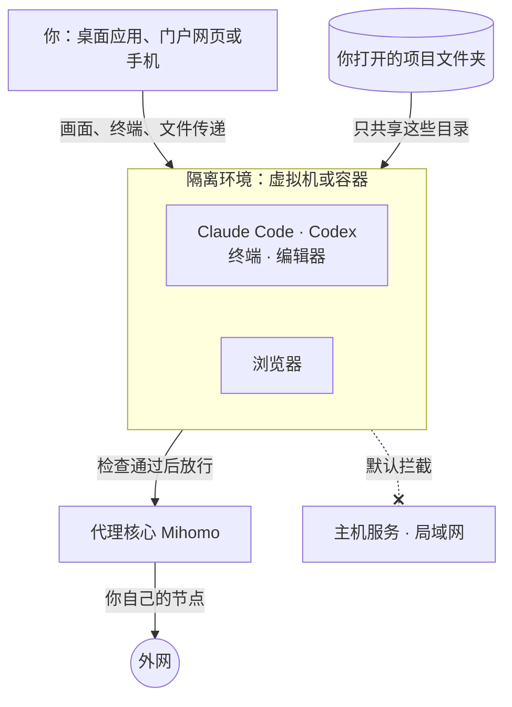
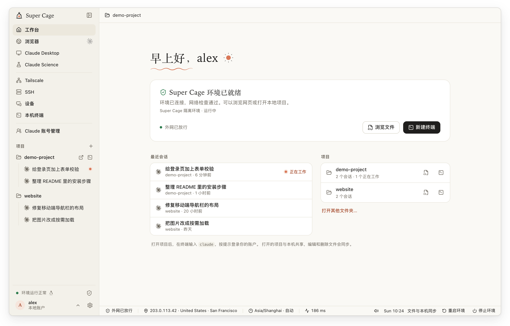
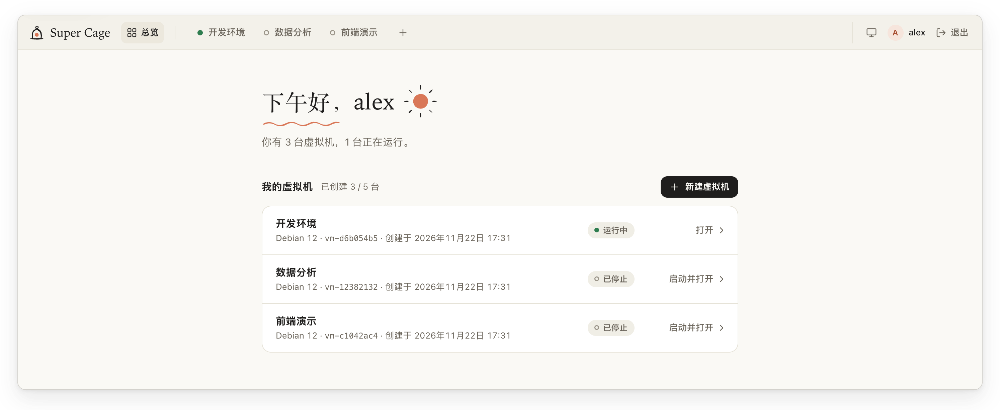
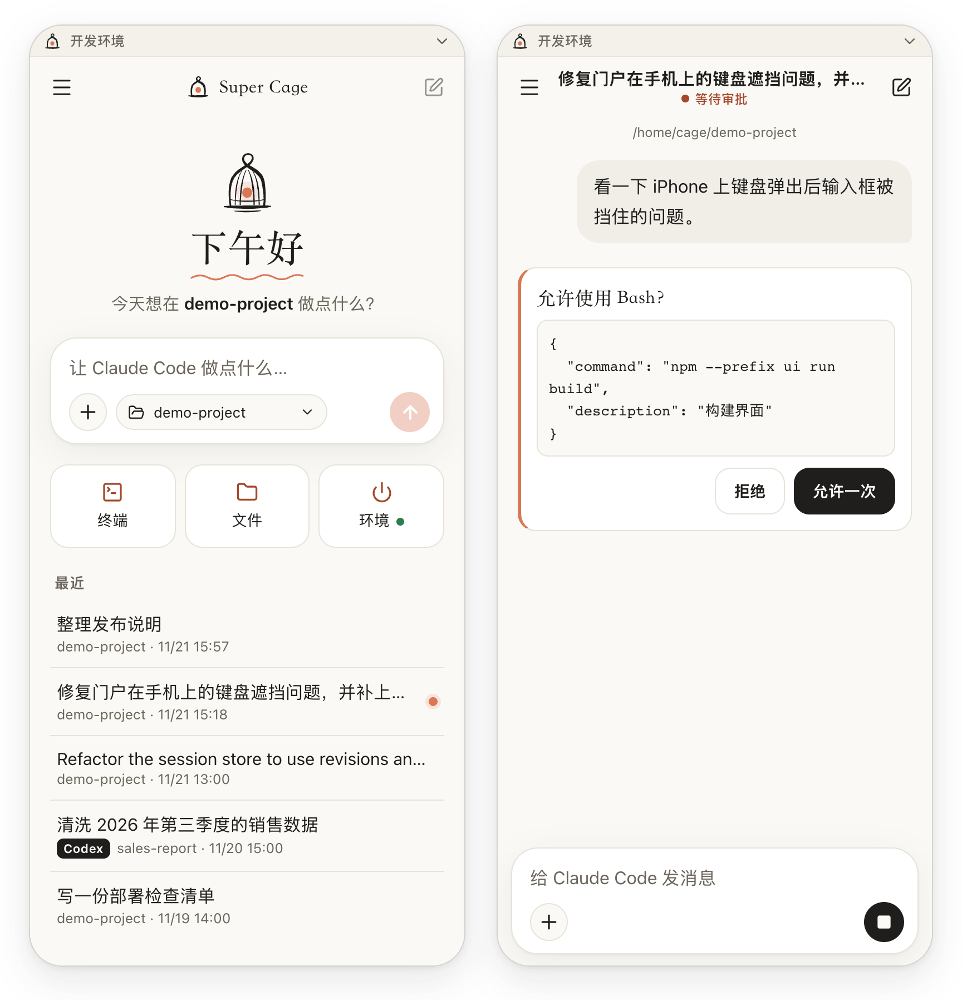
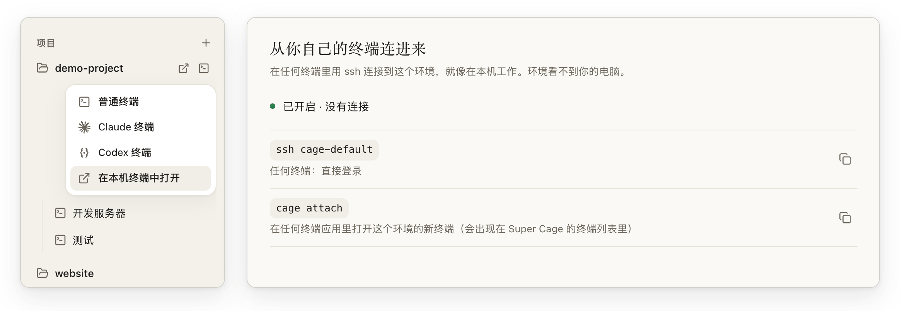
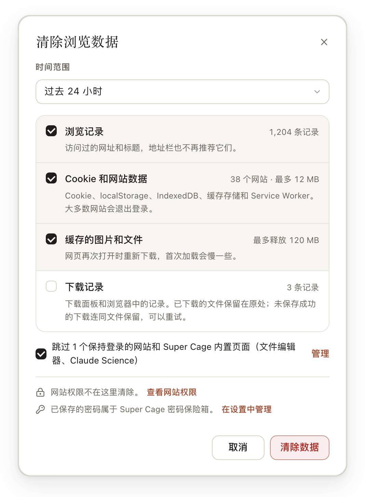
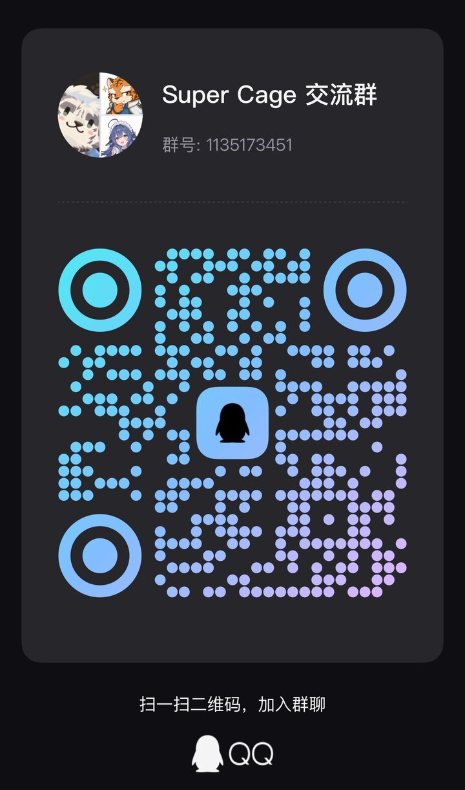

<div align="center">

<picture>
  <source media="(prefers-color-scheme: dark)" srcset="brand/mark-on-dark.svg">
  
</picture>

<h1>Super Cage</h1>

<p><strong>面向 Claude Code 与 Codex 的防封号全链路隔离工作台</strong></p>

<p>在独立虚拟机或容器中运行浏览器、终端、编辑器与 Claude Desktop，默认强代理、先检查再放行、支持单机与多租户集群。</p>

<p>
  <a href="LICENSE"></a>
  <a href="https://github.com/sweetcornna/Super-Cage/releases/latest"></a>
  
  <a href="#交流群"></a>
</p>

<p>
  <a href="#防封号与隔离设计">防封号与隔离</a> ·
  <a href="#核心功能">核心功能</a> ·
  <a href="#快速开始">快速开始</a> ·
  <a href="#文档导航">文档</a> ·
  <a href="#从源码构建">源码构建</a> ·
  <a href="#交流群">交流群</a> ·
  <a href="#许可与致谢">许可与致谢</a>
</p>


</div>

---

## 概览

**Super Cage** 提供 **桌面版**（macOS、Windows、Linux）、**Linux 服务器多租户版**（标准虚拟机版 / 无虚拟化容器版）以及 **移动端远程接续**（手机网页 / iOS / Android）：

- **一体化隔离工作台**：将 Claude Code、Codex、终端、内置浏览器、代码编辑器与官方 Claude Desktop 集成在同一窗口，全部运行在与宿主机隔离的独立环境中（如上图：左侧项目与终端，中间启动开发服务，右侧同一环境内的浏览器直连 `localhost:3000`）。
- **面向防封号设计**：围绕「独立环境、强代理出口、断网熔断自检、按机隔离配置」四个环节，最大程度降低因 IP 泄漏、DNS / UDP / IPv6 旁路、区域不一致或跨账号关联引发的风控与封号风险。
- **多端无缝衔接**：服务器版为每个账号提供独立门户与多台虚拟机；外出时可通过手机浏览器或移动端 App 继续处理同一份会话与工具审批。

---

## 防封号与隔离设计

Super Cage 采用 **默认拦截、先检后放（Fail-Closed）** 的隔离架构：

| 防护层面 | 设计机制 | 解决的风险 |
| --- | --- | --- |
| **一环境一机器** | 桌面版每个环境为本机独立虚拟机（Mac 可选 macOS / Debian / Ubuntu，Windows 使用 Hyper-V / 虚拟机监控程序平台，Linux 使用 KVM）；服务器标准版为 Incus 虚拟机，无虚拟化版为 Incus 无特权系统容器（与宿主共用内核，隔离弱于虚拟机）。 | 避免宿主机环境污染，隔离不同账号与工作区。 |
| **最小目录共享** | 仅共享明确打开的项目目录（改动直接写回原文件）；宿主机的 Claude 登录态、浏览器 Cookie、SSH 私钥与 Git 凭据**不会自动带入环境**。 | 切断宿主机凭据与历史会话的意外关联。 |
| **全流量强代理** | 业务外网全部经内置 **Mihomo** 核心与自备节点出站；默认仅放行公网 IPv4 TCP 且 DNS 走同一代理，**限制公网 UDP、IPv6、ICMP 以及到主机和局域网的直连**。 | 杜绝代理旁路、DNS 泄漏与本机局域网暴露。 |
| **先检查，再放行** | 环境启动后默认关闭外网，出口 IP、DNS、浏览器配置与网络阻断等关键检查**全部通过后才放行**；任一项失败、无法确认或出口位于中国大陆时，外网保持关闭并在状态栏写明原因与下一步。 | 避免代理失效或配置失误时回退直连暴露真实 IP。 |
| **按机独立配置** | 服务器多租户版中，每台虚拟机独立保存自身的工作台、代理订阅、节点、出口规则、DNS、时区与语言；Linux 环境支持精细清除浏览数据与重置浏览器。 | 实现“一机一号”环境独立，降低多账号关联风险。 |
| **可控多端访问** | 手机与配对电脑仅负责显示与遥控，所有命令都在目标隔离环境内执行；配对电脑无法查看主设备的设置与账户，可在「设置 → 设备」随时撤销授权。 | 兼顾移动审批便利与权限最小化边界。 |



> [!IMPORTANT]
> 网络与隔离检查反映的是当前配置和采样证据，可显著降低泄漏与关联风险，但**无法对任何第三方平台的风控策略或账号状态作出绝对不封号的保证**。Super Cage 不提供代理节点、Claude 订阅或 Codex 账号。

---

## 核心功能

### 首页总览

<p align="center">
  
</p>

启动应用即进入首页，集中展示环境状态卡、主要操作入口、最近会话与项目列表。当环境尚未启动或外网被自检暂停时，状态卡与状态栏会直接给出原因与下一步建议。

### 门户与多虚拟机

<p align="center">
  
</p>

服务器版门户为每个账号独立管理多台虚拟机，支持新建、启动、打开与顶部标签切换。每台虚拟机拥有独立的工作台、代理订阅、节点、出口规则、DNS、时区与语言配置。空闲虚拟机按冷却策略**先冻结、长时间不用再停机**，磁盘数据完整保留。

### 手机端与工具审批

<p align="center">
  
</p>

使用手机浏览器登录门户并打开虚拟机，即可直接进入移动端界面，无需安装客户端（左图）。Claude Code 会话、工具审批（右图）、终端、文件浏览与环境启停均可在手机上完成。安装 iPhone 或 Android 客户端后，还可直接配对个人电脑，继续使用电脑上的隔离环境、远程浏览器与 Claude Desktop。

### 多设备配对

<p align="center">
  
</p>

「设置 → 设备」统一管理已绑定的手机与其他电脑（最多 5 台）。「添加设备」生成有效期约两分钟的二维码与 8 位数字配对码；另一台电脑通过配对码加入时需双方核对同一组 4 位校验数字。加入后仅可使用当前电脑的移动版界面，不可访问其设置与账户。

### 在本机终端中打开

<p align="center">
  
</p>

在 macOS 桌面版中，可在终端标签页、项目或会话上选择「在本机终端中打开」（`⌘⇧O`），直接通过 Ghostty 1.3+（未安装时回退至系统终端）接管环境内的同一终端。开启「设置 → 本机终端 → 从你自己的终端连进来」后，支持在任意终端使用 `ssh <主机名>` 或 `cage ssh <环境>` 进入本机 Linux 环境，同时支持 `scp`、`sftp` 与 `rsync`。

### 浏览数据精细清理

<p align="center">
  
</p>

按下 `⌘⇧⌫`（Windows / Linux 为 `Ctrl+Shift+Delete`）打开「清除浏览数据…」，支持按时间范围清理浏览记录、Cookie 与网站数据、缓存和下载记录，并实时显示各项数量或占用空间。同时提供按站点管理的「网站数据」、清理白名单「保持登录的网站」、默认关闭的「自动清理」以及「重置浏览器」（适用于 Linux 环境；macOS / Windows 客机仍使用「管理 Cookie」面板）。

---

## 快速开始

Super Cage 支持 **桌面版**、**服务器版** 和 **手机端** 三种使用方式。无论哪种方式，都需要自行准备代理节点以及 Claude 订阅（使用 Codex 时需自备 Codex 账号）。

### 1. 桌面版

从 [v0.1.22 发布页](https://github.com/sweetcornna/Super-Cage/releases/tag/v0.1.22) 下载对应平台安装包：

| 平台 | 下载链接 | 系统要求 |
| --- | --- | --- |
| **macOS** | [`Super-Cage-0.1.22-macos-arm64.dmg`](https://github.com/sweetcornna/Super-Cage/releases/download/v0.1.22/Super-Cage-0.1.22-macos-arm64.dmg) | Apple Silicon，macOS 14 或更新 |
| **Windows** | [`Super-Cage-0.1.22-windows-amd64-setup-unsigned.exe`](https://github.com/sweetcornna/Super-Cage/releases/download/v0.1.22/Super-Cage-0.1.22-windows-amd64-setup-unsigned.exe)（未签名预览版，SmartScreen 会提示） | Windows 10 22H2 或 Windows 11，x64 |
| **Linux** | [`Super-Cage-0.1.22-linux-amd64.deb`](https://github.com/sweetcornna/Super-Cage/releases/download/v0.1.22/Super-Cage-0.1.22-linux-amd64.deb) | Debian 12、Ubuntu 22.04 或 24.04，x86-64，需支持 KVM |

> 暂不支持 Intel Mac、Windows ARM64 与 Linux ARM64。

**安装与初始化步骤：**

1. **校验安装包**：macOS 对照 `SHA256SUMS`，Linux 桌面版对照 `SHA256SUMS-linux-desktop.txt`，Windows 安装器对照 `SHA256SUMS-windows-desktop.txt`。
2. **完成安装**：
   - **macOS**：打开 DMG 并将 `Super Cage.app` 拖入「应用程序」。自 `0.1.16` 起已完成 Developer ID 签名与 Apple 公证，后续支持应用内自动更新。
   - **Linux**：运行 `sudo apt install ./Super-Cage-0.1.22-linux-amd64.deb`；如需在本机运行隔离环境，补装 `sudo apt install qemu-system-x86 qemu-utils ovmf openssh-client iproute2 git`，并确保当前用户可读写 `/dev/kvm`。
3. **首次引导**：创建 Super Cage 账户（密码不少于 8 位，妥善保存恢复密钥），选择客机系统与存储目录，导入自有代理（Clash/Mihomo YAML 订阅/文件，或 HTTP / SOCKS5 / SSH 节点），点击「开始安装」，待网络自检通过后即可进入工作台。
4. **启动工作**：点击项目旁加号打开本地项目目录，选择「新建 Claude 终端」，在隔离环境内完成 Claude Code 登录。

Windows 与 Linux 版暂不支持应用内自动安装更新，发现新版时将跳转至发布页。详见 [安装与首次启动](docs/guide/installation.md) 与 [网络与代理](docs/guide/network.md)。

---

### 2. 服务器版（多租户网关与门户）

服务器版分为 **标准版** 与 **无虚拟化版**，共用同一套网关与门户，仅底层工作区运行时不同：

| 对比项 | 标准版（推荐） | 无虚拟化版（NoVirt） |
| --- | --- | --- |
| **工作区运行时** | Incus 虚拟机 | Incus 无特权系统容器 |
| **宿主机要求** | Linux，需支持 **KVM** | Linux，**无需 KVM** |
| **隔离强度** | 独立内核（强隔离） | 与宿主共用内核（弱于虚拟机） |
| **归档名称** | `Super-Cage-Server-<版本>-linux-<架构>.tar.gz` | `Super-Cage-NoVirt-<版本>-linux-<架构>.tar.gz` |
| **部署方式** | 按部署指南手动配置 | 一条命令自动安装 |

> `v0.1.14` 及更早版本的服务端归档以 `Cage-Tenant-` 开头（例如 `Cage-Tenant-NoVirt-0.1.14-linux-amd64.tar.gz`）。网关与门户目前仍处于预览阶段，暂未内置邀请系统与账户管理命令行。

#### 无虚拟化版（一键安装）

适用于 Debian 12+、Ubuntu 22.04+（含 Ubuntu 26.04），支持 `amd64` / `arm64`，需要 `root` 权限，无需 KVM。建议预先开启 `swap`，便于冻结的工作区释放内存。

1. **下载并校验**（`arm64` 主机将命令中的 `amd64` 替换为 `arm64`）：

   ```sh
   base=https://github.com/sweetcornna/Super-Cage/releases/download/v0.1.22
   curl -fLO "$base/Super-Cage-NoVirt-0.1.22-linux-amd64.tar.gz" -fLO "$base/SHA256SUMS"
   sha256sum -c --ignore-missing SHA256SUMS
   tar -xzf Super-Cage-NoVirt-0.1.22-linux-amd64.tar.gz
   cd Super-Cage-NoVirt-0.1.22-linux-amd64
   ```

2. **执行安装**：

   ```sh
   sudo ./install.sh --origin https://cage.example.org --enable-registration
   ```

   脚本会自动安装 Incus 6.0 LTS（Zabbly 源，已安装则沿用）、调高 `inotify` 等内核参数上限、创建存储池与 NAT 工作区网络及专用项目、构建空白模板 `cage-blank`，并将网关注册为监听 `127.0.0.1:8080` 的 `systemd` 服务 `cage-tenant`。工作区默认仅允许访问公网，禁止访问宿主局域网。国内网络可追加：

   ```sh
   --image-mirror https://mirrors.tuna.tsinghua.edu.cn/lxc-images/ --debian-mirror http://mirrors.ustc.edu.cn
   ```

   更多配额与参数选项见 `./install.sh --help` 与 [无虚拟化版说明](deploy/tenant/novirt/README.md)。

3. **配置域名与 TLS 反代**：将 `cage.example.org` 与 `*.cage.example.org` 指向同一 HTTPS 反向代理，转发至 `127.0.0.1:8080` 并开启 WebSocket，配置参考 [部署指南第 4 节](deploy/tenant/README.md#4-配置-dnstls-和反代)。
4. **关闭开放注册**：首批获准账号注册完成后，移除 `--enable-registration` 重新执行 `sudo ./install.sh --origin https://cage.example.org`。

> [!NOTE]
> - 无 KVM 时，工作区内的 Super Cage 当前停在首次配置阶段（需要预装在模板里的 Super Cage 云工作环境，安装脚本暂不自动构建），详见 [无虚拟化版验证范围](deploy/tenant/novirt/README.md#验证范围)。
> - 单机快速试用可执行 `sudo ./install.sh --dev`，随后在本机运行 `ssh -L 8080:127.0.0.1:8080 <服务器>`，浏览器打开 `http://cage.localhost:8080`。

#### 标准版（KVM + Incus 虚拟机）

需要支持 KVM 且已初始化 Incus 的 Linux 主机，完整命令与安全要求详见 [宿主机部署指南](deploy/tenant/README.md)：

1. **创建专用项目**：在 Incus 中创建 `cage-tenant` 项目与存储池，并配置 CPU、内存与磁盘配额。
2. **准备空白系统镜像**：为每个系统构建不含任何用户数据的空白 VM 镜像并导入项目（例如别名 `cage-blank`）。
3. **启动网关**：下载对应架构的 `Super-Cage-Server` 归档并校验 `SHA256SUMS`，解压运行：

   ```sh
   tar -xzf Super-Cage-Server-0.1.22-linux-amd64.tar.gz
   cd Super-Cage-Server-0.1.22-linux-amd64
   ./cage-tenant \
     -origin https://cage.example.org \
     -state-dir /var/lib/cage-tenant \
     -incus-image cage-blank
   ```

   网关默认监听 `127.0.0.1:8080`，状态目录权限须设为 `0700`，生产环境请配置为 `systemd` 服务。
4. **配置域名与 TLS 反代**：将 `cage.example.org` 与 `*.cage.example.org` 指向同一 TLS 反代，转发至 `127.0.0.1:8080` 并开启 WebSocket（指南内含 Nginx 示例）。
5. **受控开放首批账号**：生产模式默认关闭注册，可在受限入口临时启用 `-enable-preview-registration`，完成首批用户注册后移除并重启。

---

### 3. 手机端

- **手机浏览器（直连服务器门户）**：直接打开门户地址并登录，进入虚拟机即自动呈现手机界面；iPhone Safari 与 Android Chrome 均可「添加到主屏幕」。网页版仅连接服务器，不支持配对电脑，也不包含远程浏览器与 Claude Desktop 入口（需要时可切至桌面版）。
- **原生手机客户端**：支持「连接服务器」（门户账号登录）与「连接电脑」（扫描电脑「设置 → 设备 → 添加设备」二维码或粘贴长配对码）。手机仅负责展示与交互，命令均在电脑或服务器环境中执行。
  - **iPhone**（iOS 17+）：通过 TestFlight 分发 —— <https://testflight.apple.com/join/qCbA6gMQ>（Apple 测试版审核通过后生效）。
  - **Android**（8.0+，arm64）：下载 [`Super-Cage-0.1.22-android-arm64.apk`](https://github.com/sweetcornna/Super-Cage/releases/download/v0.1.22/Super-Cage-0.1.22-android-arm64.apk)，对照 `SHA256SUMS` 校验后按系统提示允许安装；之后可在「设置 → 应用更新」里更新。也可按 [移动端说明](mobile/README.md#android-构建与签名) 自行构建。

---

## 文档导航

完整使用手册位于 [docs/guide](docs/guide/index.md)。手册基于当前开发构建编写，各公开安装包的功能范围请以对应发布说明为准。

| 分类 | 文档链接 |
| --- | --- |
| **新手入门** | [从这里开始](docs/guide/index.md) · [安装与首次启动](docs/guide/installation.md) · [选择客机系统](docs/guide/guest-systems.md) · [网络与代理](docs/guide/network.md) |
| **日常工作台** | [项目、终端与文件](docs/guide/workbench.md) · [本机终端](docs/guide/local-terminal.md) · [浏览器与网站数据](docs/guide/browser.md) · [Claude Desktop](docs/guide/desktop.md) · [多账号与额度](docs/guide/accounts.md) |
| **远程与协同** | [手机连接与远程会话](docs/guide/mobile.md) · [云端部署与 SSH](docs/guide/cloud.md) · [Tailscale 私网](docs/guide/tailscale.md) |
| **参考与排错** | [设置参考](docs/guide/settings.md) · [维护、资源与数据](docs/guide/maintenance.md) · [故障排查](docs/guide/troubleshooting.md) · [让 Agent 配置 Super Cage](docs/guide/agent.md) |
| **多租户服务端** | [宿主机部署指南](deploy/tenant/README.md) · [无虚拟化版说明](deploy/tenant/novirt/README.md) · [接口契约](docs/api-contract.md) |
| **平台说明** | [Windows 指南](docs/windows.md) · [Linux 指南](docs/linux.md) · [手机端说明](mobile/README.md) |

---

## 从源码构建

### 构建依赖

- **Go** `1.27.3` 或更新（同时满足 `go.mod` 与 `tools/tailnet/go.mod`）
- **Node.js** `24`
- **[uv](https://docs.astral.sh/uv/)**（用于运行 noVNC 补丁脚本）

### 常用构建与测试命令

```sh
# 桌面版（macOS / Linux）与自动化测试
bash scripts/build-app.sh                        # macOS：输出 _output/Super Cage.app
make cage-linux && make package-linux            # x86-64 Linux：输出 .deb
make test                                        # Go 单元测试
npm --prefix ui test                             # 工作台前端测试

# 服务器版与移动端
go build -o ./cage-tenant ./cmd/cage-tenant      # 仅编译多租户网关
bash deploy/tenant/package-server.sh             # 标准版归档，输出至 _output/
bash deploy/tenant/package-novirt.sh             # 无虚拟化版归档
npm ci --prefix ui && bash mobile/build.sh ios   # 移动端构建（ios 或 android）
```

> - Windows 版需在 Windows x64 上通过 PowerShell 7 运行 `make cage-windows` 与 `make package-windows`，另需 `.NET SDK`、MSYS2 与 NSIS，详见 [Windows 源码构建](docs/windows.md#windows-源码构建)。
> - 打包脚本要求干净的 Git 工作区；iOS 与 Android 签名安装流程见 [手机端说明](mobile/README.md)。

---

## 交流群

使用问题、功能建议和部署经验，欢迎到 QQ 交流群讨论。

<p align="center">
  <a href="https://qm.qq.com/q/qUf3uBmJji"></a>
</p>

<p align="center">QQ 群号 <strong>1135173451</strong> · 手机 QQ 扫码，或<a href="https://qm.qq.com/q/qUf3uBmJji">点此加入</a></p>

---

## 许可与致谢

### 开源许可

Super Cage 以 [MIT 许可](LICENSE) 发布。随附第三方组件保留各自许可，详见 [NOTICE](NOTICE) 与 [THIRD_PARTY_LICENSES](THIRD_PARTY_LICENSES)；Mihomo 及 macOS 客机辅助组件的对应源码随发布页提供。

### 鸣谢

- **核心致谢 [Claude Cage](https://github.com/Lee-xeo/Claude-Cage)**：Super Cage 基于 Lee-xeo 的开源项目 **Claude Cage**（MIT）重构与改进。桌面工作台、隔离环境、代理与联网自检、手机客户端以及 `docs/guide` 使用手册均源自 Claude Cage；Super Cage 在此基础上扩展了多租户网关与门户，并重做了整体交互界面。衷心感谢 Lee-xeo 与 Claude Cage 的每一位贡献者。
- **底层生态与参考项目**：Claude Cage 基于 Sylvain Zimmer 的 [agent-vm](https://github.com/sylvinus/agent-vm)（MIT），Super Cage 同时使用并受益于以下开源项目：
  - [Lima](https://github.com/lima-vm/lima)、[sshocker](https://github.com/lima-vm/sshocker)、[gvisor-tap-vsock](https://github.com/containers/gvisor-tap-vsock)、[pkg/sftp](https://github.com/pkg/sftp)：虚拟机管理、SSH 转发与挂载、用户态网络和 SFTP（源码位于 `third_party/`，含 agent-vm 与 Cage 的定制修改）
  - [QEMU](https://www.qemu.org/)：Windows 与 Linux 宿主机运行 Linux 客机
  - [Mihomo](https://github.com/MetaCubeX/mihomo)：独立运行的内置代理核心
  - [Incus](https://github.com/lxc/incus)：服务器版的虚拟机与无特权系统容器运行时
  - [xterm.js](https://github.com/xtermjs/xterm.js)、[noVNC](https://github.com/novnc/noVNC)、[React](https://react.dev/)、[Lucide](https://lucide.dev/)：工作台终端、远程画面与界面组件
  - [SSHFS](https://github.com/libfuse/sshfs)：macOS 客机项目目录挂载
  - [Dormice](https://github.com/BitMiracle-AI/Dormice)：多租户网关空闲冷却（先冻结、再停机）的设计思路

其余第三方组件清单请参阅 [NOTICE](NOTICE) 与 [THIRD_PARTY_LICENSES](THIRD_PARTY_LICENSES)。

Super Cage 是独立开源项目，与 Anthropic 和 OpenAI 无任何隶属关系。
