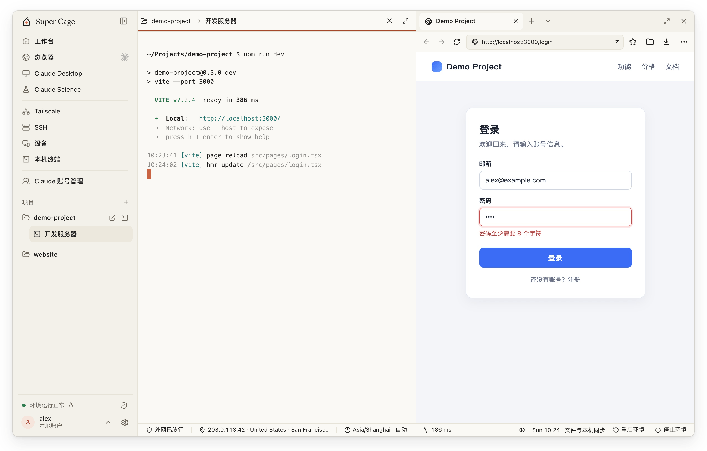
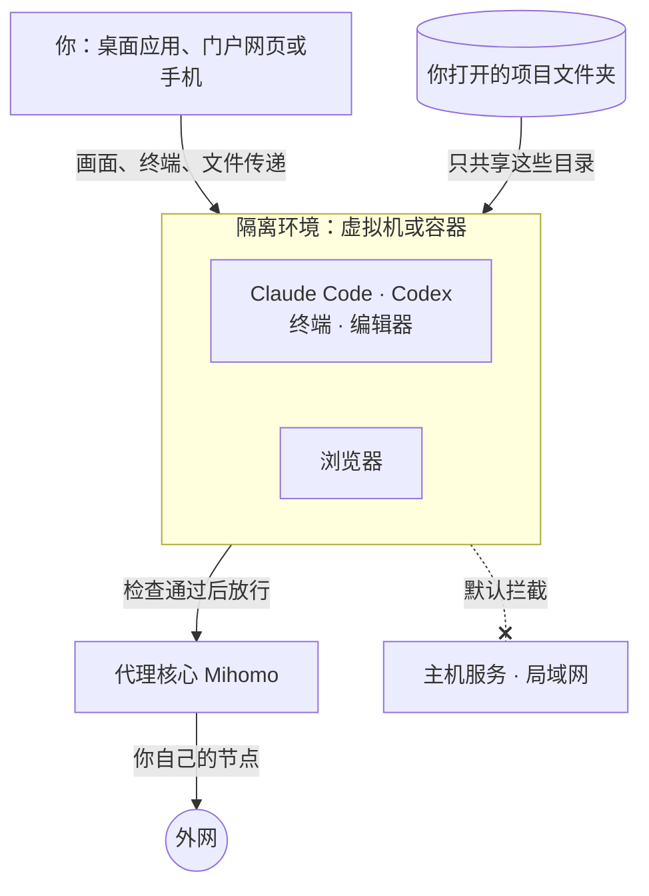

<div align="center">

<picture>
  <source media="(prefers-color-scheme: dark)" srcset="brand/mark-on-dark.svg">
  
</picture>

<h1>Super Cage</h1>

<p>让 Claude Code 和 Codex 在隔离的虚拟机或容器里工作，自带浏览器、终端、文件和独立的网络出口。</p>

[](LICENSE)
[](https://github.com/sweetcornna/Super-Cage/releases/latest)

</div>

<p align="center">
  
</p>

Super Cage 有桌面版（macOS、Windows、Linux）和 Linux 服务器版。桌面版把终端、浏览器、编辑器和 Claude Desktop 放进一个工作台，它们都运行在一台与主机隔离的虚拟机里。上图中间是环境里的终端，右边是同一环境里的浏览器，打开的是终端里启动的 `localhost:3000`。服务器版给每个账号一个门户，可以开多台虚拟机。手机可以接着处理同一份会话。

## 它能做什么

### 首页

<p align="center">
  
</p>

打开应用先看到首页：问候、一张环境状态卡和一个主要操作，下面是最近会话和项目。环境没有启动或外网被暂停时，卡片和状态栏写明原因和下一步。

### 手机

<p align="center">
  
</p>

用手机浏览器登录门户、打开虚拟机，直接就是手机界面，不用装客户端（左）。Claude Code 会话、工具审批（右）、终端、文件和环境启停都能在手机上处理。iPhone 和 Android 客户端还能配对你自己的电脑，接着使用电脑上的环境、远程浏览器和 Claude Desktop。

### 设备

<p align="center">
  
</p>

「设置 → 设备」把手机和其他电脑放在一处，最多 5 台。「添加设备」显示二维码和 8 位数字配对码，约两分钟有效。另一台电脑用数字配对码加入时，两边要核对同一个 4 位数字。加入后，那台电脑可以打开这台电脑的手机版界面，但看不到它的设置和账户。

### 门户与虚拟机

<p align="center">
  
</p>

服务器版的门户列出每个账号自己的虚拟机，可以新建、启动、打开和切换。每台虚拟机有自己的工作台和独立设置，代理订阅、节点、出口规则、DNS、时区和语言都按虚拟机保存。空闲的虚拟机先冻结，长时间不用再停机，磁盘保留。

### 在本机终端中打开

<p align="center">
  
</p>

在 macOS 桌面版里，终端标签页、项目或会话上选「在本机终端中打开」（⌘⇧O），用 Ghostty 1.3 或更新版本打开环境里的同一个终端；没有安装 Ghostty 时用系统终端。在「设置 → 本机终端」打开「从你自己的终端连进来」后，可以在任何终端里用 `ssh <主机名>` 或 `cage ssh <环境>` 进入本机的 Linux 环境，scp、sftp 和 rsync 也能用。

### 浏览数据

<p align="center">
  
</p>

「清除浏览数据…」（⌘⇧⌫，Windows 和 Linux 上是 Ctrl+Shift+Delete）按时间范围清除浏览记录、Cookie 和网站数据、缓存和下载记录，每项旁边显示数量或大小。另有按网站查看的「网站数据」、清除时跳过的「保持登录的网站」、默认关闭的「自动清理」和「重置浏览器」。这些需要 Linux 环境，macOS 和 Windows 客机仍用「管理 Cookie」面板。

## 快速开始

有三种用法：在自己的电脑上装桌面版；在 Linux 服务器上部署，让多人用浏览器访问；用手机接着处理。三种都需要你自己的代理节点和 Claude 订阅（用 Codex 时是 Codex 账号），Super Cage 不提供这两样。

### 桌面版

从 [v0.1.17 发布页](https://github.com/sweetcornna/Super-Cage/releases/tag/v0.1.17)下载：

| 电脑 | 安装包 | 要求 |
| --- | --- | --- |
| Mac | [`Super-Cage-0.1.17-macos-arm64.dmg`](https://github.com/sweetcornna/Super-Cage/releases/download/v0.1.17/Super-Cage-0.1.17-macos-arm64.dmg) | Apple Silicon，macOS 14 或更新 |
| Windows | [`Super-Cage-0.1.17-windows-amd64-setup-unsigned.exe`](https://github.com/sweetcornna/Super-Cage/releases/download/v0.1.17/Super-Cage-0.1.17-windows-amd64-setup-unsigned.exe)（未签名的预览版） | Windows 10 22H2 或 Windows 11，x64 |
| Linux | [`Super-Cage-0.1.17-linux-amd64.deb`](https://github.com/sweetcornna/Super-Cage/releases/download/v0.1.17/Super-Cage-0.1.17-linux-amd64.deb) | Debian 12、Ubuntu 22.04 或 24.04，x86-64，需要 KVM |

Intel Mac、Windows ARM64 和 Linux ARM64 暂不支持。

1. **校验**：macOS 安装包对照 `SHA256SUMS`，Linux 桌面安装包对照 `SHA256SUMS-linux-desktop.txt`，Windows 安装器对照 `SHA256SUMS-windows-desktop.txt`。
2. **安装**：Mac 上打开 DMG，把 `Super Cage.app` 拖进「应用程序」。从 0.1.16 起，App 和 DMG 经 Developer ID 签名和 Apple 公证，之后的版本可以在应用内更新。Linux 上运行 `sudo apt install ./Super-Cage-0.1.17-linux-amd64.deb`；要在本机运行环境，再装 `sudo apt install qemu-system-x86 qemu-utils ovmf openssh-client iproute2 git`，并确认当前用户能读写 `/dev/kvm`。
3. **首次启动**：创建 Super Cage 账户（密码至少 8 个字符，保存好恢复密钥），选择客机系统和存储目录，导入自己的代理（Clash/Mihomo YAML 订阅或文件，或 HTTP、SOCKS5、SSH 节点），点「开始安装」。网络检查通过后进入工作台。
4. **开始工作**：点项目旁的加号打开自己的文件夹，选「新建 Claude 终端」，在环境里登录 Claude Code。

Windows 和 Linux 版不在应用内安装更新，有新版时按钮打开发布页。详细步骤见[安装与首次启动](docs/guide/installation.md)和[网络与代理](docs/guide/network.md)。

### 服务器

两个版本使用同一个网关和门户，区别在于工作区的运行方式。

| | 标准版 | 无虚拟化版 |
| --- | --- | --- |
| 工作区 | Incus 虚拟机 | Incus 无特权系统容器 |
| 宿主要求 | Linux，支持 KVM | Linux，不需要 KVM |
| 隔离 | 独立内核 | 与宿主共用内核，弱于虚拟机 |
| 下载 | `Super-Cage-Server-<版本>-linux-<架构>.tar.gz` | `Super-Cage-NoVirt-<版本>-linux-<架构>.tar.gz` |
| 安装 | 按部署指南手动配置 | 一条命令安装 |

v0.1.14 及更早版本的归档名以 `Cage-Tenant-` 开头，例如 `Cage-Tenant-NoVirt-0.1.14-linux-amd64.tar.gz`。

#### 无虚拟化版

适用于 Debian 12 及更新、Ubuntu 22.04 及更新（包括 Ubuntu 26.04），amd64 或 arm64，需要 root 权限，不需要 KVM。建议先开启 swap，冻结的工作区靠它释放内存。

1. **下载并校验**（arm64 主机把文件名中的 `amd64` 换成 `arm64`）：

   ```sh
   base=https://github.com/sweetcornna/Super-Cage/releases/download/v0.1.17
   curl -fLO "$base/Super-Cage-NoVirt-0.1.17-linux-amd64.tar.gz" -fLO "$base/SHA256SUMS"
   sha256sum -c --ignore-missing SHA256SUMS
   tar -xzf Super-Cage-NoVirt-0.1.17-linux-amd64.tar.gz
   cd Super-Cage-NoVirt-0.1.17-linux-amd64
   ```

2. **安装**：

   ```sh
   sudo ./install.sh --origin https://cage.example.org --enable-registration
   ```

   脚本安装 Incus 6.0 LTS（Zabbly 软件源，已装则沿用），调高 inotify 等内核上限，创建存储池、带 NAT 的工作区网络和专用项目，构建空白模板 `cage-blank`，再把网关注册为 systemd 服务 `cage-tenant`（监听 `127.0.0.1:8080`）。工作区默认只能访问公网，不能访问宿主局域网。国内网络可加 `--image-mirror https://mirrors.tuna.tsinghua.edu.cn/lxc-images/ --debian-mirror http://mirrors.ustc.edu.cn`。资源上限等选项见 `./install.sh --help` 和[无虚拟化版说明](deploy/tenant/novirt/README.md)。

3. **配置域名和 TLS**：把 `cage.example.org` 和 `*.cage.example.org` 指向同一个 HTTPS 反向代理，转发到 `127.0.0.1:8080` 并开启 WebSocket，见[部署指南第 4 节](deploy/tenant/README.md#4-配置-dnstls-和反代)。
4. **关闭注册**：首批账号注册完后，不带 `--enable-registration` 再运行一次 `sudo ./install.sh --origin https://cage.example.org`。

工作区内的 Super Cage 目前停在首次配置：没有 KVM 时，它的工作环境需要预装在模板里的 Super Cage 云工作环境，安装脚本还不会构建。详见[无虚拟化版说明](deploy/tenant/novirt/README.md#验证范围)。

只想先在一台机器上试用，可以用 `sudo ./install.sh --dev`，然后在自己电脑上 `ssh -L 8080:127.0.0.1:8080 <服务器>`，浏览器打开 `http://cage.localhost:8080`。

#### 标准版

服务端需要一台支持 KVM、已安装和初始化 Incus 的 Linux 主机。下面是大致步骤，具体命令和安全要求见[部署指南](deploy/tenant/README.md)。

1. **创建专用项目**：在 Incus 中创建 `cage-tenant` 项目和存储池，并设置 CPU、内存和磁盘配额。
2. **准备系统镜像**：为每个系统制作不含用户数据的空白 VM 镜像，导入项目，例如命名为 `cage-blank`。
3. **启动网关**：下载与主机架构对应的服务端归档并校验，然后运行：

   ```sh
   tar -xzf Super-Cage-Server-0.1.17-linux-amd64.tar.gz
   cd Super-Cage-Server-0.1.17-linux-amd64
   ./cage-tenant -origin https://cage.example.org \
     -state-dir /var/lib/cage-tenant -incus-image cage-blank
   ```

   网关默认监听 `127.0.0.1:8080`。状态目录的权限应为 `0700`。正式环境请配置为 systemd 服务。
4. **配置域名和 TLS**：把 `cage.example.org` 和 `*.cage.example.org` 指向同一个 TLS 反向代理，转发到 `127.0.0.1:8080`，并开启 WebSocket。部署指南里有 Nginx 示例。
5. **开放首批账号**：生产模式默认关闭注册。先在受限入口临时加上 `-enable-preview-registration`，等获准用户注册完再去掉。

网关和门户仍是预览版，没有邀请系统和账户管理命令行。

### 手机

**门户里的虚拟机**：用手机浏览器打开门户地址并登录，进入虚拟机后就是手机界面，iPhone 的 Safari 和 Android 的 Chrome 都能「添加到主屏幕」。网页版只连接服务器，不能配对电脑，也不显示远程浏览器和 Claude Desktop 入口，需要时切到电脑版。

**手机客户端**：「连接服务器」用门户账号登录；「连接电脑」扫描电脑「设置 → 设备 → 添加设备」里的二维码，或粘贴长配对码。手机只负责连接和显示，命令在电脑或服务器上执行。

**iPhone**（iOS 17 或更新）通过 TestFlight 分发。

TestFlight 公开链接：<https://testflight.apple.com/join/qCbA6gMQ>（Apple 测试版审核通过后生效）

**Android**（8.0 或更新，arm64）：发布页暂不提供 APK，可以按[移动端说明](mobile/README.md#android-构建与签名)用 `bash mobile/build.sh android` 自己构建。

## 隔离是怎样做的

- **一个环境一台机器**：桌面版的每个环境是本机上的一台虚拟机（Mac 上可选 macOS、Debian 或 Ubuntu 客机，Windows 上用 Hyper-V 或 Windows 虚拟机监控程序平台，Linux 上用 KVM）。服务器标准版的每个工作区是一台 Incus 虚拟机；无虚拟化版是一个 Incus 无特权系统容器，与宿主共用内核，隔离弱于虚拟机。
- **只共享你打开的文件夹**：项目改动直接写回原文件。主机上的 Claude 登录、浏览器 Cookie、SSH 私钥和 Git 凭据不会自动带进环境。
- **外网只走你的代理**：环境的连接经 Super Cage 随附的 Mihomo 核心和你导入的节点出去。默认支持公网 IPv4 TCP，DNS 走同一代理；公网 UDP、IPv6、ICMP 以及到主机和局域网的直连受限。
- **先检查，再放行**：环境启动后外网先关闭，出口、DNS、浏览器配置和网络阻断等关键检查都通过才放行。任何一项失败或无法确认，外网保持关闭，状态栏写明原因；出口在中国大陆时也保持关闭。
- **其他设备只是遥控**：手机和加入的电脑只负责显示和操作，命令都在环境里执行。在「设置 → 设备」移除一台设备，就撤销了它的访问。



## 文档

使用手册在 [docs/guide](docs/guide/index.md)。手册描述当前开发构建，公开安装包包含哪些功能，以发布说明为准。

- 开始：[从这里开始](docs/guide/index.md) · [安装与首次启动](docs/guide/installation.md) · [选择客机系统](docs/guide/guest-systems.md) · [网络与代理](docs/guide/network.md)
- 日常：[项目、终端与文件](docs/guide/workbench.md) · [本机终端](docs/guide/local-terminal.md) · [浏览器与网站数据](docs/guide/browser.md) · [Claude Desktop](docs/guide/desktop.md) · [多账号与额度](docs/guide/accounts.md)
- 远程：[手机连接与远程会话](docs/guide/mobile.md) · [云端部署与 SSH](docs/guide/cloud.md) · [Tailscale 私网](docs/guide/tailscale.md)
- 参考：[设置参考](docs/guide/settings.md) · [维护、资源与数据](docs/guide/maintenance.md) · [故障排查](docs/guide/troubleshooting.md) · [让 Agent 配置 Super Cage](docs/guide/agent.md)
- 服务器：[部署指南](deploy/tenant/README.md) · [无虚拟化版说明](deploy/tenant/novirt/README.md) · [接口契约](docs/api-contract.md)
- 平台：[Windows](docs/windows.md) · [Linux](docs/linux.md) · [手机端](mobile/README.md)

## 从源码构建

需要 Go 1.27.3 或更新（同时满足 `go.mod` 和 `tools/tailnet/go.mod`）、Node.js 24，以及运行 noVNC 补丁脚本的 [uv](https://docs.astral.sh/uv/)。

```sh
bash scripts/build-app.sh                  # macOS：生成 _output/Super Cage.app
make cage-linux && make package-linux      # x86-64 Linux：生成 .deb
make test                                  # Go 测试
npm --prefix ui test                       # 工作台界面测试
```

Windows 版在 Windows x64 上用 PowerShell 7 运行 `make cage-windows` 和 `make package-windows`，另需 .NET SDK、MSYS2 和 NSIS，见 [Windows 源码构建](docs/windows.md#windows-源码构建)。

服务器和手机端：

```sh
go build -o ./cage-tenant ./cmd/cage-tenant   # 只编译网关
bash deploy/tenant/package-server.sh          # 标准版归档，输出到 _output/
bash deploy/tenant/package-novirt.sh          # 无虚拟化版归档
npm ci --prefix ui && bash mobile/build.sh ios   # 或 android
```

打包脚本要求干净的 Git 工作区。iOS 和 Android 的签名与安装见[手机端说明](mobile/README.md)。

## 许可

Super Cage 以 [MIT 许可](LICENSE)发布。随附的第三方组件保留各自的许可，见 [NOTICE](NOTICE) 和 [THIRD_PARTY_LICENSES](THIRD_PARTY_LICENSES)；Mihomo 和 macOS 客机辅助组件的对应源码随发布页提供。

## 致谢

Super Cage 建立在 Lee-xeo 的 [Claude Cage](https://github.com/Lee-xeo/Claude-Cage)（MIT）之上。桌面工作台、隔离环境、代理与联网检查、手机客户端，以及 docs/guide 里的使用手册，都来自 Claude Cage。Super Cage 在它的基础上加入了多租户网关和门户，并重做了界面。感谢 Lee-xeo 和 Claude Cage 的每一位贡献者。

Claude Cage 又基于 Sylvain Zimmer 的 [agent-vm](https://github.com/sylvinus/agent-vm)（MIT）。Super Cage 还用到这些项目：

- [Lima](https://github.com/lima-vm/lima)、[sshocker](https://github.com/lima-vm/sshocker)、[gvisor-tap-vsock](https://github.com/containers/gvisor-tap-vsock)、[pkg/sftp](https://github.com/pkg/sftp)：虚拟机管理、SSH 转发与挂载、用户态网络和 SFTP，源码在 `third_party/`，带有 agent-vm 和 Cage 的修改
- [QEMU](https://www.qemu.org/)：Windows 和 Linux 上运行 Linux 客机
- [Mihomo](https://github.com/MetaCubeX/mihomo)：独立运行的代理核心
- [Incus](https://github.com/lxc/incus)：服务器版的虚拟机和系统容器
- [xterm.js](https://github.com/xtermjs/xterm.js)、[noVNC](https://github.com/novnc/noVNC)、[React](https://react.dev/)、[Lucide](https://lucide.dev/)：工作台的终端、远程画面和界面
- [SSHFS](https://github.com/libfuse/sshfs)：macOS 客机里的项目挂载
- [Dormice](https://github.com/BitMiracle-AI/Dormice)：网关空闲冷却（先冻结、再停机）的思路

其余组件见 [NOTICE](NOTICE) 和 [THIRD_PARTY_LICENSES](THIRD_PARTY_LICENSES)。

Super Cage 是独立项目，与 Anthropic 和 OpenAI 没有隶属关系。
