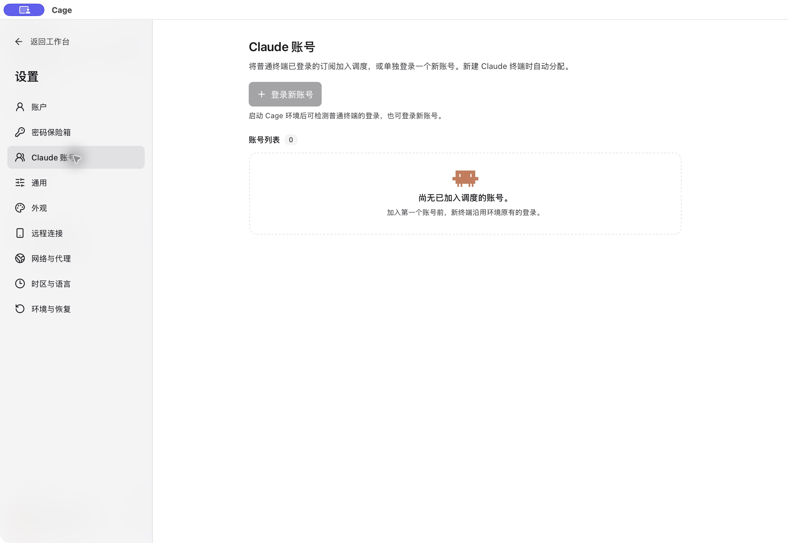

## 先区分三类账户

| 账户或登录 | 用途与归属 |
| --- | --- |
| Super Cage 账户 | 解锁当前主机的 Super Cage 工作台。 |
| Claude Code 账号 | 授权环境内终端使用 Claude 订阅，由侧栏“Claude 账号管理”管理与调度。 |
| 网页与 Claude Desktop 登录 | 各自保存登录状态，不会自动加入 Claude Code 调度。 |

点击侧栏“Claude 账号管理”查看账号列表；登录和查询额度前，先启动环境并等待工具就绪。账号功能以所用构建为准；没有该面板时先核对版本。

官方客户端启动时会筛除管理用环境变量，状态栏、登录回调和手机渠道只接收运行所需的信息。账户、凭据、历史和项目保留原位；配置和辅助程序通过临时引用访问。客户端仍拥有正常的终端和项目访问能力，这些处理无法保证供应商不能识别运行环境。

<figure class="guide-shot">
  
  <figcaption>Claude 账号面板：环境未启动、尚未登记账号。截图版本：0.1.6-alpha-preview（开发构建） · macOS 原生应用 · 2026-11-07。<a href="images/claude-accounts.jpg" target="_blank" rel="noopener">查看原图（2560 × 1764） ↗</a></figcaption>
</figure>

## 将已有登录加入调度

在 Super Cage 普通终端运行 `claude auth login`。如果终端显示 Claude 官方授权链接，点击它即可在 Super Cage 浏览器的临时标签中继续。按页面提示完成后，回到原终端确认登录结果。

登录成功后，账号面板会显示默认终端检测到的邮箱。核对后点“加入调度”。它只读取 Super Cage 环境里的登录，不读取主机系统终端上的账号。

如果普通终端原先是 A，后来登录成 B，Super Cage 会停止将默认目录分配给 A。B 需要单独加入。要让 A、B 长期共存，保留一份默认登录，另一个账号通过独立登录添加。

## 添加另一个订阅

1. 在侧栏“Claude 账号管理”点“登录新账号”。
2. 按打开的登录终端和临时授权浏览器提示完成官方登录。每个独立登录使用自己的配置目录。
3. 成功后账号按邮箱登记，可编辑备注，检查“参与自动分配”是否开启。
4. 点击项目旁的终端图标，新建 Claude 终端，查看标签所显示的分配账号。

取消登录不会增加可调度账号。同一订阅不会重复参与调度。独立账号需要重新登录时，先关闭仍使用它的终端，再按面板提示处理。

通过“登录新账号”再次授权已有独立账号时，Super Cage 会按邮箱和组织匹配原账号。macOS 和 Linux 环境中，原目录缺少文件凭据，且该账号没有运行中的终端、手机任务或登录操作时，可以用本次授权恢复原登录；账号目录、已有会话、备注和参与设置保持不变。恢复后需由官方 CLI 确认身份，已有凭据不会被覆盖。

Windows 环境、钥匙串登录、已有凭据或恢复检查失败时，请等待该账号的手机任务结束，关闭使用原账号的终端，再从原账号卡片点击“打开登录终端”或“重新登录”。检查失败会保留已经发布的凭据，避免影响同时进行的其他登录；面板只有在确认身份后才会报告恢复成功。

## 自动分配什么时候发生

自动分配发生在新建 Claude 终端时。在“调度设置”中选择：

- **均衡分配**：考虑正在使用的终端数量和已知剩余额度，条件相近时轮转，并兼顾同一项目近期使用的账号。
- **按列表顺序优先**：优先使用排在前面的可用账号，相关额度已耗尽、登录失效或暂停分配时使用后面的账号。通过“上移”调整顺序。

关闭某个账号的“参与自动分配”，只影响以后新建的终端，正在使用该账号的任务可以继续。改变调度模式不改变已有会话的账号绑定。

想让新会话都用某个账号时，在它的卡片上点“新会话使用此账号”。新会话会优先用它，即使它没有开启参与分配；它不会因此参与自动分配，也不会成为自动接续的目标。它额度用完或需要登录时，新会话按上面的分配方式选择其他账号。点“恢复按规则分配”取消。

## 共享技能、指令和记忆

登录凭据各自独立，Super Cage 会话列表统一展示历史。项目文件、项目中的指令与技能直接共用；用户级的本地技能、指令、规则和代理定义共用环境内的资料，同一个项目的自动记忆使用同一位置。更换账号后可以继续使用这些资料。主机系统的个人配置不会自动导入。

从 Claude.ai 账号或组织下载的技能仍属于原账号；登录身份、凭据、账号远程设置和 MCP 的账号授权不自动合并。原有资料同名且内容不同时，Super Cage 保留原文件并提示先核对，避免覆盖用户资料。

## 在同一会话中换账号

电脑终端上方和手机会话中的账号按钮显示当前绑定，两边是同一套操作。

**手动切换。** 展开账号按钮，“切换到”下面列出你的其他所有账号，并注明剩余额度、额度已用完及重置时间、额度未知或未参与自动分配。点哪个就换到哪个，不需要分组，也不需要另外勾选同意。原会话正在执行任务，或还有子代理、后台命令在运行时，会先问一次“会停止当前任务并切换到 B，继续吗？”，有后台任务时写明数量，它们也会停止；原会话已经因确认的额度用完而停下时不再询问。因服务过载或其他错误停下的会话不算用完：仍在运行的任务同样先问一次，没有任务时直接切换，不停止任何东西。还没登录的账号会显示出来，但不能选；先在账号管理里登录。

**额度用完时。** 只有官方 CLI 报告限额、并且额度读数确认五小时或七天窗口已用完时才算用完；服务过载、未知错误或只针对某个模型的限额都不算。用完时按“调度设置”里的“额度用完时”处理：

- **每次询问**（默认）：会话里出现一张卡片，例如“A 的额度已用完（周限额，11/27 18:00 重置）。要换到 B 继续吗？会话历史会带到 B。”可以选“切换并继续”（只这一次）、“以后额度用完都自动接续”、“等 A 恢复”（只这一次）或“以后都等待”。在电脑或手机任一处回答，另一处的卡片随之消失。回答之前会话不会被移动，已经发出但没被处理的消息留在原处。第一次出现前，“调度设置”里也会提供同一个问题。
- **自动换账号继续**：会话自动换到还有额度、参与分配的账号继续，界面只留一行“A 的额度已用完（周限额，11/27 18:00 重置），已换到 B 继续”，旁边的“撤销”会回到 A 并等它恢复：任务不会在 A 上继续，B 上还没处理的消息也等 A 恢复后才送达；在那之前再换账号，这些消息随会话带到新账号。可以接续的账号都用完时，会话等最先恢复的账号，届时自动继续。自动接续被拒绝时（例如找不到这段会话的历史），会话里写明原因；账号或会话有变化时再试，否则每 15 分钟最多再试一次。
- **等原账号恢复**：不换账号，会话里写明重置时间。Claude Code 自己的额度菜单这时仍开着，恢复后要在电脑终端里选择继续；在此之前随时可以手动切换。

每个会话可以在账号菜单里设自己的规则，或选“跟随调度设置”。在会话里作出的选择只管那个会话。这一版之前创建的会话，如果记录的是“额度耗尽后自动接续”或“始终等待原账号”，保持不变（自动接续仍只在接续分组内进行）；其余跟随调度设置。

**接续分组只限制自动接续。** 设了分组的账号只和同组账号互相接续。没有分组的账号之间自动接续，需要你在作出选择的地方同意：在“调度设置”里勾选“没有设接续分组的账号之间也自动接续”，或在“调度设置”的提问、以及两个没有分组的账号之间的卡片上选“以后额度用完都自动接续”，对所有跟随调度设置的会话有效；在某个会话的菜单里选“自动换账号继续”，或在它的卡片上选“切换并继续”，只对那个会话有效。只把调度设置里的规则改成“自动换账号继续”不算这个同意；在一个接续分组内的卡片上选“以后额度用完都自动接续”也不算，之后没有分组的账号之间用完时还会再问一次。工作账号和个人账号请分到不同分组，以免会话历史自动进入另一身份。分组不构成文件系统安全隔离。

**交接时会发生什么。** 目标账号运行新的官方 CLI 进程，恢复同一份历史，原历史保留。因确认的额度用完或你确认停止而换账号时，原会话的 Claude Code，以及作为它的子进程运行的后台命令和子代理会被停止，未完成的工具审批作废；自己脱离了 Claude Code 的命令可能还在运行。目标账号会被告知这次停止：没有完成的步骤和仍在运行的后台任务逐项列出，并提醒它脱离的命令可能还在运行，由它核对后决定是否重做。其他切换只结束空闲的 Claude Code，不停止任何子进程。没有结果的工具调用不会被重新执行。已经发出、但原账号还没处理的消息会在目标账号空闲后送达一次。同一账号的其他会话不受影响。跨账号的服务端提示缓存可能重建，第一轮可能更慢。

需要你处理的拒绝每次都会说明下一步：目标账号没有登录、账号身份已经改变、找不到这段会话的历史，或 Claude Code 正在项目以外的文件夹里运行（写明那个文件夹，在那里退出 Claude Code 或回到项目文件夹后再切换）。环境或会话连接还没就绪、原进程还没退出这类暂时状态，也会用一句话说明稍后怎么做。其他意外错误只显示一句通用说明，详细信息只记在服务日志里。

这套能力运行客机中的原版 Claude Code，不提取订阅令牌代理模型请求，令牌不会离开各自的账号目录。当前代码已接入 Linux、macOS 和 Windows 客机路径；原生客机须使用匹配的环境组件，Windows 还需登录并解锁绑定的客机桌面。

额度用完后的自动接续、带着后台命令的交接、运行中的子代理被中断后由目标账号接手，以及手动切换的一次确认，都已在隔离的官方 CLI 中验证，测试使用合成账号、本地模型响应和真实格式的限额响应。真实双订阅服务端兼容性、原生客机完整登录与交接，以及供应商对自动轮换的具体许可仍须核实。CLI 版本或组织策略不支持 Channels 时，手机接续能力也会受到限制。

## 查看五小时和七天额度

打开面板会向环境内的官方 Claude Code 查询五小时、七天用量与重置时间。卡片的“检查状态”可以立即刷新，无需先发一条模型消息。

某个额度窗口没有返回读数时，界面会说明结果，并保留该窗口上次的百分比和读取时间。旧读数不能视为实时可用额度，也不能代表服务一定接受下一条请求。

## 无账号可分配时

按以下顺序检查：账号是否成功登录、是否开启参与分配、是否已达到已知额度、预计重置时间是否已到。先点“检查状态”，身份失效时按提示重新登录。

普通终端切换过账号时，检查新身份是否单独加入调度。官方授权或请求失败，继续查[Claude 登录与账号异常](troubleshooting.md#claude-登录与账号异常)。

## Codex 账号

Linux 环境的侧边栏另有“Codex 账号管理”，与 Claude 账号分开保存和调度：

- “登录新账号”会打开登录终端，运行 `codex login --device-auth`。在任意浏览器打开终端显示的 https://auth.openai.com/codex/device ，登录 ChatGPT 后输入一次性验证码，完成后账号自动加入调度。
- 每个账号使用独立的 `CODEX_HOME`（虚拟机内 `~/.local/share/cage/codex-accounts/<ID>/home`），登录凭据、会话、历史和日志互不共用。`~/.codex` 中的 `AGENTS.md`、`prompts/`、`rules/` 和技能会链接到各账号；`config.toml` 只共用模型、审批、沙盒、功能开关等本地设置，模型服务商、接口地址、密钥、代理和登录方式始终留在各账号自己的配置中。带环境变量、请求头或凭据参数（如 `--token`、`Authorization: Bearer …`）的 MCP 服务器和 `notify` 命令也不共用。
- 新建“Codex 终端”时按调度设置（均衡分配或按列表顺序）自动选择账号，已暂停、需要登录或额度已用尽的账号会被跳过。若所选账号已退出或换了身份，Codex 终端会提示后结束，并在后台重新检查该账号，之后不再分配给新终端。额度来自账号最近一次的用量查询和本地会话记录中的速率限制。
- 列表为空时，Codex 终端沿用环境的 `~/.codex` 登录；列表中有账号但都不可用时，会提示检查账号，不会悄悄改用默认登录。
- Codex 终端不会在会话中途切换账号；切换授权随设置保存。macOS 和 Windows 环境暂不提供 Codex 账号和 Codex 终端。
