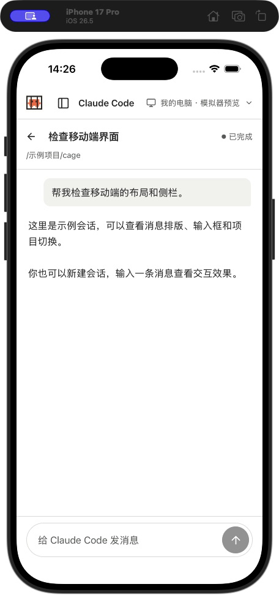

## 获取客户端与使用条件

在 Android 或 iPhone 安装 Super Cage 手机客户端，再与电脑配对。Android 需要 8.0 及更新的 arm64 设备和现代 System WebView；iPhone 需要 iOS 17+ 与 Secure Enclave。手机与电脑应使用匹配版本。

Android 用户在 [GitHub 发布页](https://github.com/sweetcornna/Super-Cage/releases/latest)下载 `Super-Cage-<版本>-android-arm64.apk`，按系统提示允许该下载来源安装应用。后续使用同一签名的新版 APK 覆盖安装，保留手机上的配对记录。

iOS 用户在自己的 Mac 上构建并为设备签名，步骤见下文。

电脑需运行 Super Cage、解锁账户并准备好环境。手机负责连接与显示，Claude Code、网络出口、时区和语言由配对电脑上的 Super Cage 管理。电脑离线或停止环境后，手机无法继续在该环境运行任务。

桌面通过 SSH 切到服务器时，手机接口仍指向原电脑的本机 Super Cage。请切回本机工作台管理设备。

“设置 → 设备”（侧栏的“设备”也能打开）把手机和其他电脑放在同一处：这台电脑上可以连接它的设备，以及这台电脑自己加入的其他电脑。

## 在手机浏览器使用网页版

不安装客户端，也可以用手机浏览器使用服务器上的 Super Cage。打开管理员提供的门户地址并登录，进入虚拟机后直接显示手机界面，首次打开只下载手机界面需要的内容。iPad 等平板打开电脑版工作台。

- **切换版本**：侧栏底部点“电脑版”改用完整工作台，电脑版右下角点“手机版”切回。通过门户打开时，每台虚拟机分别记住自己的选择，新建的虚拟机仍按设备自动判断；在本机直接打开工作台时，同一浏览器共用一个选择。清除网站数据后重新自动判断。电脑浏览器把窗口拉窄时仍保持电脑版。
- **门户栏**：进入虚拟机后，屏幕顶部保留一条细栏，显示 Super Cage 标志和虚拟机名称。这条细栏由门户显示，虚拟机里的页面无法遮挡；点一下展开门户栏，可以回到虚拟机列表、切换虚拟机或退出登录。
- **返回**：系统返回键或边缘侧滑先关闭侧栏和弹出面板，再回到上一个页面。在门户中打开的虚拟机，再返回就回到虚拟机列表；侧栏底部的“返回门户”效果相同。
- **屏幕与键盘**：旋转屏幕或展开折叠屏时停留在当前页面。横屏和较宽的屏幕把侧栏固定在左侧。键盘弹出时输入框留在键盘上方，刘海和底部横条不会遮住按钮。
- **添加到主屏幕**：iPhone 在 Safari 点分享按钮，选“添加到主屏幕”；Android 在 Chrome 菜单选“添加到主屏幕”或“安装应用”。之后从桌面图标全屏打开门户。
- **登录过期**：工作台登录过期时，门户核对自己的登录状态，仍有效就重新进入虚拟机并回到原来的页面；门户登录也已过期时，重新登录门户。
- **链接**：点回复中的网页链接后，门户在页面底部列出链接所在的网站，展开“完整地址”可以查看全部内容。确认后点“打开”，链接在新标签页打开。

网页版只连接浏览器能访问的服务器，不能扫码或用配对码连接自己的电脑，也不会申请电脑防休眠。页面切到后台时浏览器可能暂停连接，回到前台后自动刷新。文件上传和下载通过浏览器完成。门户虚拟机的手机界面不显示远程浏览器和 Claude Desktop 入口，需要时切换到电脑版。

## iOS 本地构建

1. 在 Mac 安装完整 Xcode 和 iOS SDK，首次打开 Xcode 完成组件安装。准备 Node.js 24 与 Go，Go 版本遵循仓库中的 `go.mod`。
2. 下载 [Super Cage 源码](https://github.com/sweetcornna/Super-Cage)，在仓库根目录执行以下命令，生成手机界面、原生连接库和 iOS 应用。

   ```sh
   npm ci --prefix ui
   bash mobile/build.sh ios
   open mobile/ios/CageMobile.xcodeproj
   ```

3. 在 Xcode 选择 `CageMobile` scheme，在 Signing & Capabilities 中选择自己的开发团队，连接 iPhone 并选择该设备，再点击 Run。按设备提示信任开发签名并启用开发者模式。

构建产物位于 `mobile/.build/ios/`，设备证书与签名由自己的 Apple 开发账户管理。安装后按照下文配对电脑。需要导出供本人设备安装的开发 IPA，可查看[移动端构建说明](https://github.com/Lee-xeo/Claude-Cage/blob/main/mobile/README.md#ios-本地构建)。

## 添加设备：扫码或输入配对码

1. 电脑进入“设置 → 设备”，点“添加设备”。窗口显示二维码和 8 位数字配对码（较早的版本只有二维码和长配对码），下方是倒计时，约两分钟有效。
2. **手机**：首页点“连接电脑 → 扫码连接”，允许相机并扫描完整二维码。相机不方便时，在电脑点“复制长配对码”，手机选择配对码入口，粘贴这串一次性代码。已安装的手机客户端不用更新，原有配对也保持不变。
3. **另一台电脑**：在它的 Super Cage 里点“设备 → 加入其他电脑”，输入 8 位数字（也可以粘贴长配对码），可以顺便给这台电脑起个名字。
4. 用数字配对码加入时，这台电脑会显示“某某想加入这台电脑”和一个核对数字。核对数字与那台电脑上显示的一致，再点“允许”；不一致或不认识这台设备，点“拒绝”。
5. 点“允许”后，那台电脑的窗口会再显示一次核对数字，并问“与那台电脑上显示的数字一致再确认”。它点“确认”后，才会添加；点“不一致”、关闭窗口、锁定或 60 秒内没有答复，都不会添加任何东西，这边会提示“对方没有确认核对数字，没有添加”。扫二维码和粘贴长配对码不需要核对数字这两步。
6. 手机连接成功后会打开左侧栏。点工具即可在主区操作，点左上角的 Super Cage Logo 可以重新打开侧栏。下次可在“连接电脑”里重新连接已配对设备。

两台电脑要使用同一个中继（见下文）；配对码属于另一个中继时，加入窗口会说明两边各用哪一个。

配对码授予设备访问，请只交给你要授权的设备，关闭窗口后它立即失效。锁定 Super Cage、重新生成配对码、拒绝加入或等待配对码超时，都会使尚未使用的配对码失效。窗口里的配对码只能在电脑桌面窗口里生成，自动化脚本和 `cage agent` 不能生成，也不能代为加入或允许。

## 设备列表与移除

“设置 → 设备”的“可以连接这台电脑的设备”列出每台设备的名称（手机显示型号）、“手机 · iOS”或“电脑 · macOS”这样的类型，以及上次连接的时间。正在连接的设备右侧有一个橙色圆点，页头显示“3 台设备 · 1 台在线”。最多 5 台设备，满了以后先移除一台才能再添加。

点设备右侧的“移除”并确认，该设备要重新配对才能访问这台电脑，正在进行的操作会立即中断。如果手机显示“型号待获取”，请更新手机端 Super Cage 后重新连接；已有配对会保留，无需重新扫码。

有设备配对时，这台电脑保持运行，屏幕可以熄灭；移除全部设备后恢复原来的休眠设置。

## 加入其他电脑

“设备 → 加入其他电脑”输入另一台电脑显示的配对码后，那台电脑出现在“我加入的电脑”里。点“打开”，窗口会换成那台电脑的手机版界面，窗口顶部写着“电脑名称 · 手机版功能”。需要回到自己的工作台时，点顶部或侧栏底部的“返回本机”。

加入的电脑得到的功能和手机完全相同：Claude Code 会话与审批、终端、文件、环境的启动与停止、远程浏览器和 Claude Desktop。它看不到那台电脑的设置、账户、项目编辑器，也不能在那台电脑上添加或移除设备。目前只能通过手机版界面操作，不能打开那台电脑的完整桌面工作台。

“我加入的电脑”里的“移除”只是让这台电脑忘记它。要撤销授权，还要在那台电脑的“设置 → 设备”里移除这台电脑。这台电脑的 Super Cage 锁定时，已打开的窗口会立即断开，也不能新打开。

电脑重启后，先打开 Super Cage。如果使用“记住我”自动登录，已配对的手机和加入的电脑可以直接重连并使用 Claude Desktop 等工具。手动选择“锁定 Super Cage”会立即中止所有设备的访问。在电脑上解锁后，设备可继续使用原配对。

有设备已配对、Super Cage 主机后台正在提供远程服务时，会请求主机保持运行，不论配对了几台设备都只请求一次。屏幕可以照常熄灭，设备暂时断开或主机正在重连中继时也保留待机。关闭窗口或选择“保留运行并退出”仍会保持远程服务及防休眠。移除全部设备或结束主机后台服务后释放请求，沿用原系统休眠设置。“设置 → 设备”显示防休眠是否已申请；系统不允许申请时显示具体原因。

这项能力用于阻止系统自动休眠。合盖、手动强制休眠、关机与系统电源保护仍受操作系统和硬件限制。长时间无人值守远程使用应保持接电，避免系统在电池模式撤销防休眠请求。

## 创建会话与处理工具审批

在左侧栏的“Claude Code”分区点项目名，展开后点会话即可进入对话。手机自动连接已有会话或恢复历史，无需再点接续按钮，也无需回电脑确认 Super Cage 通道。连接准备期间可以先输入消息，发送按钮在连接就绪后可用。也可以在目标项目旁新建会话。手机可查看回复、执行进度与保存的历史，运行时可以停止本轮。没有项目时，先在电脑工作台明确添加一个目录。

会话中的标题、列表、引用、代码和表格按 Markdown 排版。宽表格和长代码行可以左右滑动。点开“工具调用”能看到每次调用的名称、状态，以及记录中附带的简短说明。后台任务通知直接显示摘要，展开可看任务编号和输出路径。

当回复用 Markdown 链接、图片语法或行内代码引用当前项目的媒体文件时，点“查看图片”或“加载视频”可在对话里预览。文件通过配对连接从电脑传到手机，单个文件上限为 48 MiB。支持 PNG、JPEG、GIF、WebP，以及手机能够解码的 MP4、M4V、MOV 和 WebM 视频。公网链接在电脑的 Super Cage 远程浏览器里打开。项目文件预览和工具调用历史需要手机与电脑都使用支持此功能的版本。

需要执行工具时，手机显示工具名称和参数，选择“允许一次”或“拒绝”。先检查参数中的命令、文件路径和操作范围。同一项审批若已被另一端处理，重新读取最新状态。

在会话行从右向左滑动，右侧会露出置顶、重命名和归档图标，按钮与会话位于同一行。点击更多操作按钮也可展开，键盘左方向键展开，右方向键或 Escape 收起。名称、置顶和归档状态在电脑与手机同步。归档会关闭关联终端并保留历史。

在“设置 → 已归档会话”中，可以搜索会话、按项目筛选，并通过“取消归档”恢复到项目列表。垃圾桶按钮用于永久删除，会要求再次确认，并清理对应 Claude Code 原始对话和子代理记录。删除无法撤销。主机环境离线时可以查看及取消归档，永久删除需要启动主机环境。

电脑和手机均可勾选会话进行批量处理。列表上方的“全选”选择当前筛选结果，项目名前的复选框选择该项目下当前显示的会话；也可逐项选择，再点击“批量取消归档”或“批量删除”。切换搜索或筛选条件会清空选择。批量删除需要确认；部分操作失败时，成功项从归档列表移除，失败项保持选中，可查看原因后重试。删除未完成的会话只能重试删除，无法取消归档。

电脑与手机读取同一份会话目录。手机创建的会话也可在电脑直接打开，两端共用历史、消息和审批。后台重启后，历史会话仍在列表中，两端点击会话均可接续。手机切换会话时保留各自草稿，退出页面不关闭主机上的任务。已有历史在接续前会核对原账号与项目；原配置不可验证时保留历史并报告具体问题。

连接短暂中断时，手机自动重试五次，间隔逐步拉长。恢复期间显示当前进度，聊天记录与草稿保留。发送结果不明确时，App 先核对消息是否已送达，需要重试时沿用原消息，避免重复执行。主机确认接收后立即显示“消息已送达”，回复随后同步。五次仍未恢复时，提示会说明手机与电脑之间、或电脑与运行环境之间的连接问题；点击“再次连接”可继续恢复，无需手动复制原消息。

获授权项目中的既有 Claude Code 历史也会进入列表。打开后自动接续空闲会话；等待审批的任务会在手机重新请求批准。正在执行的任务保持运行，完成后自动连接。共享会话直接复用当前进程。账号失效、主机离线或组织策略禁止连接时，页面显示实际错误。续聊会检查账号与服务地址，身份变化时拒绝继续；无法核实身份的配置只支持首轮，可按提示新建会话。

<figure class="guide-shot guide-shot-phone">
  <a href="images/mobile-ios-preview.jpg" target="_blank" rel="noopener" aria-label="查看原图：手机原生客户端的会话界面预览"></a>
  <figcaption>手机原生客户端的会话界面预览。截图版本：Super Cage iOS 0.1（build 1，开发版） · iPhone 17 Pro 模拟器 · iOS 26.5 · 2026-11-07 · 界面预览，示例对话，未连接主机。<a href="images/mobile-ios-preview.jpg" target="_blank" rel="noopener">查看原图（456 × 972） ↗</a></figcaption>
</figure>

## 在手机打开远程浏览器

1. 电脑启动环境并通过网络检查。
2. 用电脑生成的二维码或配对码连接。已配对手机可以直接重新连接。
3. 在手机左侧栏点「浏览器」，会打开电脑 Super Cage 浏览器设置中的「新标签页地址」。电脑保存新地址后，下次从手机打开浏览器即生效。「Claude.ai」入口始终直达 Claude.ai。
4. 点击网页输入框，再用“输入文字”调用手机键盘；点勾号插入，需要提交时再点“发送回车”。

点手机浏览器底部的「收藏夹」，可以按电脑上的文件夹浏览收藏、打开网址，或把当前页存入指定文件夹。两端共用配对主机的收藏。另一端有更改时，重新打开收藏夹，或在手机上点刷新即可看到。

网页在电脑的 Super Cage 中运行，每部配对手机使用独立浏览资料，首次需要在这份窗口里登录。普通关闭保留该配对的登录资料。移除配对或锁定 Super Cage 会中止访问。

手机浏览器显示单个网页，支持公网 IPv4 的 HTTP/HTTPS。需要网页弹窗登录、附件上传下载或声音播放时，请回到电脑工作台操作。

## 在手机操作 Claude Desktop

在电脑 Super Cage 环境内安装并登录 Claude Desktop。用已配对手机连接电脑，在手机左侧栏点“Claude Desktop”，即可接续电脑上的同一窗口。两端共用账号、应用数据、页面和输入焦点，手机的操作同步显示在电脑上。应用尚未运行时由主机启动。

新版手机端会自动读取屏幕像素密度，使远程画面匹配当前显示分辨率。共享窗口会按手机宽度重新排版，电脑同步显示该布局。需要看细节时可点“放大阅读”并拖动查看局部。退出手机的 Desktop 页面后恢复电脑尺寸，电脑里的应用和任务继续运行。需要重新登录或使用本机文件选择器时，在电脑上完成。

Windows 客机的手机 Desktop 已接入共享窗口、焦点和尺寸协议，旧客机组件会提示更新，锁屏后需在电脑解锁绑定账户。当前已通过生产接口与隔离图形协议检查；Windows 官方 Claude 窗口、真实鼠标与锁屏、实体手机 WebView 的完整流程仍待验收。具体可用范围取决于电脑端构建、客机组件和平台验证。

## 断网、切换设备与撤销

短暂断网后先留在当前会话，网络恢复时读取最新进度，会重新核对电脑身份。输入草稿保留；发送或审批时断线，先确认主机记录，避免重复操作。主机已接受的任务可以继续运行。

点 Super Cage Logo 打开侧栏，点底部“退出”回到首页，再从“连接电脑”的已连接设备中选另一台电脑。长按设备并确认“取消连接”可关闭该设备的连接，配对记录继续保留。在手机“忘记主机”清除本机保存的连接；要撤销电脑端授权，还要在电脑“设置 → 设备”移除对应设备。

## 使用自建中继

电脑在“设置 → 设备”页面底部的“中继服务”选择自建中继并保存 HTTPS 地址，手机和要加入的电脑也设置同一地址。需管理令牌时只在电脑填写。保存后再添加设备，已有配对不会自动搬到另一台中继，迁移需撤销并重新配对。

中继转发连接，不运行你的项目。它可以看到连接地址、时间和流量大小；电脑与手机在转发通道内核对身份并加密通信。自建中继需使用与手机协议匹配的部署程序，部署材料与命令行连接助手见[中继说明](https://github.com/Lee-xeo/Claude-Cage/blob/main/deploy/relay/README.md)。
